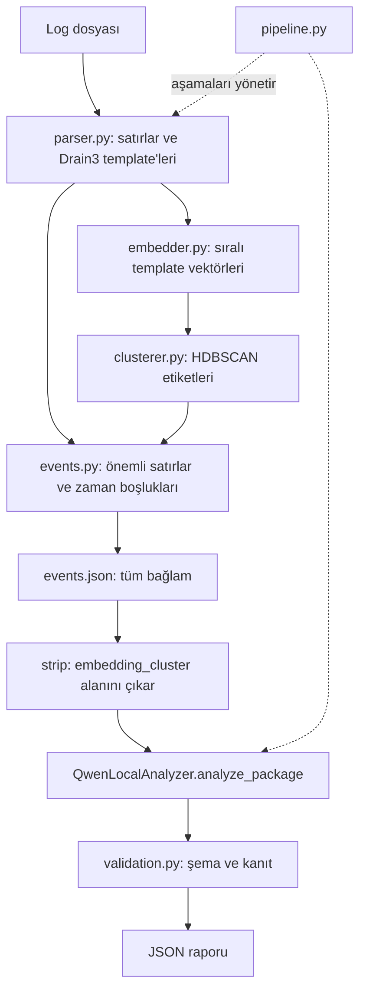

# Uygulama durumu

Spring Boot uygulama backend'i `backend/` altında uygulanmıştır. Dosyalar ve işler PostgreSQL'e atomik olarak kaydedilir; arka plan worker'ları lease/heartbeat ve sahiplik token'larıyla FastAPI'yi çağırır. Sonuçlar, olaylar, kanıtlar ve deneme geçmişi kalıcıdır. API sözleşmesi, durum geçişleri ve çalıştırma adımları: [docs/BACKEND.md](docs/BACKEND.md). Java tarafı parsing veya kümeleme algoritmalarını yeniden uygulamaz.

FastAPI servisi artık `ai_service/` altında uygulanmıştır. Çalıştırma, yapılandırma ve sınırlar için [docs/SERVICE.md](docs/SERVICE.md) dosyasına bakın. Parsing, kümeleme ve olay oluşturma kaynakları `processing.py` içinde; model kaynakları ve sıralı çağrılar `pipeline.py` içinde birleştirilmiştir. Aşağıdaki metin ilk tasarım planını kaydeder; önerilen bütün ayrı dosya adları birebir oluşturulmamıştır.

# Mimari ve Entegrasyon Planı

Temel: Berkaycetinn/log-analyzer, commit `98956406ddaf7fd0f45837d17b3026b52d38ac64`.
Bu belge mevcut notebook algoritmalarını sonraki uygulama adımında birleştirmek için tasarımdır. Aşağıdaki .py dosyaları, yeni fonksiyon imzaları ve doğrulama katmanı henüz uygulanmamıştır. Mevcut kaynaklar için [PROJECT_ANALYSIS.md](PROJECT_ANALYSIS.md) incelenmelidir. Hücre indeksleri sıfır tabanlıdır.

## Mimari kararı

Tek dosya/batch işlem hattı kullanılacak. Parsing, template embedding'i, semantik kümeleme, zamansal olay oluşturma ve LLM analizi ayrı sorumluluklar olacak. Başlangıçta mevcut Hadoop davranışı korunacak. FastAPI ve Streamlit, çekirdek işlem hattı doğrulandıktan sonra aynı servis girişini kullanacak.



Drain3 cluster_id, HDBSCAN hdb ve zamansal event_id farklı kimliklerdir. Hiçbiri birbirinin yerine kullanılmayacak. HDBSCAN -1 etiketi kayıt silme nedeni olmayacak. LLM her embedding kümesine ayrı çağrılmayacak; mevcut davranış bütün olay paketini tek çağrıda analiz etmektir.

## Kaynakların kesin eşlemesi

| Hedef modül | Mevcut kaynak | Entegrasyon işlemi |
|---|---|---|
| parser.py | 0_2 hücre 3 build_miner/run_drain; 04 hücre 1 regex, MASKS, ts, SUSP/BENIGN ve tpl | Fonksiyonları açık girdilerle taşı; son kullanılan 04 önem kuralını kullan |
| embedder.py | 03 hücre 6 embed; 03 hücre 7 ve 04 hücre 1 seçili model/encode | Modeli dışarıdan ver; ham template ve normalize_embeddings=True koru |
| clusterer.py | 04 hücre 3 run_hdb, hücre 4 MCS ve hücre 6 cid2hdb | Global emb yerine parametre; etiketleri aynı tpl sırasına bağla |
| events.py | 04 hücre 2 extract_params/_num/field_stats; hücre 7 template_item ve paket | df, tmap, cid2hdb, MASKS bağımlılıklarını açık parametre yap |
| events.py | 04 hücre 9 preceding_lines; hücre 10 related ve activity_per_minute | Ara dosya yazımları yerine tek son paket üret |
| hadoop_context.py | 04 hücre 10 prog hazırlığı ve hücre 12 att_rows/silence/pre_storm_facts | Hadoop'a özel zenginleştirmeyi açık profile bağla |
| analyzer.py | 05 hücre 1 strip; hücre 2 model yükleme; hücre 3 SYSTEM; hücre 13 QwenLocalAnalyzer | Mevcut sınıfı taşı; torch import'unu ekle; model/tokenizer/prompt enjekte et |
| validation.py | 05 hücre 5 all_strings/norm/check_evidence; hücre 11 score | Mevcut metriği uyumluluk ölçümü olarak koru; yeni doğrulamayı ayrı katman yap |
| pipeline.py | Mevcut karşılığı yok | Aşamaları sırayla çağır, artefakt ve hata durumunu yönet |
| api.py / app.py | Yalnız README planı | Çekirdeği çağır; model veya algoritmayı yeniden uygulama |

veri_kesfi'deki kaba mask fonksiyonu, parametre taramaları, embedding alternatifleri, komşuluk gösterimleri, port tabloları ve tekrarlı LLM deneyleri araştırma notebook'larında kalacak. Bunlar normal analiz isteğinde çalıştırılmayacak.

## Önerilen çekirdek arayüzleri

```python
parse_logs(lines, config) -> ParsedBatch
embed_templates(templates, model) -> EmbeddingBatch
cluster_templates(embedding_batch, config) -> ClusterBatch
build_events(parsed_batch, cluster_batch, config) -> dict
enrich_hadoop_context(package, parsed_batch) -> dict
prepare_payload(package) -> str
QwenLocalAnalyzer.analyze_package(payload_str, thinking=True,
                                max_new_tokens=12000) -> dict
validate_report(report, package) -> ValidationResult
run_analysis(input_path, config, resources, output_dir) -> AnalysisResult
```

Qwen sınıfının imzası mevcut; diğer üst seviye imzalar öneridir. Notebook'ları import ederek veya tüm hücreleri exec ederek çalıştırmak yerine algoritma gövdeleri sonraki adımda fonksiyonlara taşınacak. Böylece pip/clone, deney döngüleri ve eski r2 durumu servis çağrısına karışmayacak.

## Veri sözleşmeleri

### ParsedBatch

- rows: DataFrame. date/time/level/thread/component/message, ts, cluster_id, template, suspicious, important, params.
- templates: cluster_id başına bir kayıt; template, component (mod), count, n_important, first, last ve important.
- tmap: Drain3 cluster_id → nihai template.
- Önerilen ek meta: fiziksel satır numarası/raw_line ve eşleşmeyen satır kayıtları. Mevcut algoritmanın message girdisi aynen korunacak.
- Giriş sırası Drain3'e verilir; template'ler tüm mesajlar işlendiğinde alınır. Zamansal sıralama olay oluştururken uygulanır.
- first/last için 04'teki tam timestamp kullanılacak. 03 CSV'sinin saat alanları otomatik olarak tam tarih sayılmayacak.

### EmbeddingBatch ve ClusterBatch

EmbeddingBatch, sıralı cluster_id listesi ve aynı sıradaki (T, 768) normalize vektörleri taşır. HDBSCAN etiket dizisi uzunluğu T olmalıdır. Eşleme, satır indeksiyle farklı bir tabloya körlemesine atama yerine saklanan template kimlikleri üzerinden doğrulanır.

Model: all-mpnet-base-v2. Metin: template. HDBSCAN: sklearn.cluster.HDBSCAN, min_cluster_size=2, min_samples=1, metric=euclidean. MCS ve önem eşikleri bu belge kapsamında değişmez.

templates.csv ve embeddings.npy yeniden kullanımında aynı çalıştırmaya ait kimlik sırası, template metni ve model revision doğrulanmalı. Mevcut 04 dosyadan okumadığı için bu özellik sonraki adaptör çalışmasıdır.

### EventPackage: mevcut events.json biçimi

Üst alanlar:

- sample_start, sample_end: tam timestamp metinleri.
- n_rows_total: eşleşen satır sayısı; fiziksel dosya satır sayısı olduğu varsayılmamalı.
- note: örneğin sample_end'de kesildiği uyarısı.
- events: olay listesi.
- activity_per_minute: saat:dakika → normal/flagged sayıları.
- pre_storm_facts: Hadoop ilerleme ve sessizlik bilgileri.

Her olay: event_id, start, end, n_rows, templates, context_before, preceding_lines, related_lines.

Her template özeti: template, example, count, first, last, levels, varying_fields, embedding_cluster. varying_fields girdileri unique ve example, sayısal alanlarda min/max taşır. Örnek metin ilk mesajdan en fazla 250 karakterdir.

Önemli satırların ardışık zaman farkı >30 saniye olduğunda olay değişir. n_rows yalnız o olayın önemli satırlarını sayar. context_before, önceki 120 saniyedeki önemli satırları içerir; preceding_lines tüm satırlardan önceki 5 kaydı alır. related_lines yalnız <=5 satırlı olaylarda, örneklerdeki container/attempt/job/task ID'lerine göre ±120 saniyede en fazla 15 kayıt içerir. Bu bağlam olaylar arasında nedensellik iddiası değildir.

Hadoop pre_storm_facts: note, map_attempt_progress, longest_silence_all_lines, largest_event_first_line, first_normal_line_after_largest_event_start. İlerleme kaydı attempt, first_report, last_report, last_value, identical_tail_reports, longest_report_gap_sec, gap_from, gap_to ve outcome içerir. Bunlar genel log sözleşmesinin zorunlu alanları yapılmayacak.

### LLM sınırı ve rapor

prepare_payload, 05 hücre 1'deki strip davranışıyla yalnız embedding_cluster anahtarlarını özyinelemeli çıkarır; ensure_ascii=False, indent=1 ile serileştirir. Tam events.json inceleme için saklanır.

Model/tokenizer bir kez yüklenip kaynak nesnesi olarak verilir. Kullanılacak çağrı:

```python
analyzer = QwenLocalAnalyzer(model, tok, SYSTEM)
report = analyzer.analyze_package(
    prepare_payload(package), thinking=True, max_new_tokens=12000
)
```

final_report = r2 kullanılmayacak. Sınıfın üretim ve JSON ayıklama algoritması korunacak. Thinking modunda temperature=0.6, top_p=0.95, top_k=20 ve do_sample=True; thinking kapalıysa 0.7/0.8/20. Model Qwen/Qwen3-14B, torch_dtype="auto", device_map="auto".

SYSTEM açıklamaları Türkçe, alıntıları özgün dilde ister. Çıktı: events ve cross_event_notes. Her analiz olayı event_id, summary, severity, likely_root_cause, confidence, confidence_reason, evidence, assumptions, alternative_explanations, unknowns, recommended_checks, recommended_fix taşır. severity: none/low/medium/high; confidence: low/medium/high; kök neden ve çözüm null olabilir.

## Orkestrasyon ve sınır kontrolleri

1. Dosya formatını ve boş giriş durumunu kontrol et; eşleşmeyen satır sayılarını raporla.
2. Bir çalıştırmaya özel yeni Drain3 miner oluştur; satırları parse et, bayrakları ve template tablosunu çıkar.
3. Template sırasını sabitle, embedding üret, şekil/sonlu değer/eşleme kontrolü yap.
4. HDBSCAN uygula, tüm etiketleri (-1 dahil) koru.
5. Önemli satırlardan olayları ve bağlamı üret; Hadoop profili uygunsa ek olguları hesapla.
6. Son paketi tek seferde events.json olarak kaydet; LLM payload'ını hazırla.
7. Gerçek tokenizer ile girdi+çıktı bütçesini kontrol et. Sığmıyorsa açık kapasite hatası ver; sessizce bağlam kesme. Olay bazlı bölme ayrı, henüz uygulanmamış geliştirmedir.
8. analyze_package çağır, raporu doğrula, final_root_cause_report.json ve ayrı validation sonucu üret.

Yeni sınır davranışları algoritma ayarlarından ayrıdır: önemli satır yoksa boş events ile LLM çağrısını atla; HDBSCAN için yetersiz template varsa desteklenmeyen girdi durumunu açıkça bildir; eksik Hadoop ilerleme verisinde profil alanlarını gerekçesiyle atla. Notebook'taki max/iloc/time varsayımlarının genel girdilerde çalıştığı iddia edilmeyecek.

ValidationResult önerisi: valid, errors, warnings. Şema/alan tipleri ve enum'lar, tekil event_id'ler ve girişteki tüm olayların tam bir kez kapsanması kontrol edilecek. Alıntı en fazla 200 karakter olmalı; ilgili olayın gönderilen örnek veya bağlam metninde birebir bulunmalı ve zamanı uygun kaynak kaydıyla eşleşmeli. Mevcut normalize paket geneli metriği ayrıca karşılaştırma için tutulacak. Bu yeni denetimler mevcut check_evidence'ın zaten yaptığı işler değildir.

JSON parse, model yükleme, kapasite veya doğrulama hatasında aşama ve hata ayrıntısı kaydedilecek; sonuç doğrulanmış başarı diye sunulmayacak. Şema geçmesi nedenselliği kanıtlamaz; öneriler insan incelemesine açık kalır. severity=none ayrı gösterilmeli; boş recommended_checks listesi arayüzde indeks hatası üretmemelidir.

## Çalıştırma ve kaynak yönetimi

Önerilen yerel çıktı düzeni runs/<run_id>/ altında events.json, final_root_cause_report.json, validation.json ve manifest.json'dur. Manifest giriş özeti/hash'i, kaynak commit'i, bağımlılık/model/data revision'ları ve parametreleri taşır. Çıktı dosyaları çalıştırmalar arasında karışmamalıdır.

Embedding modeli ve Qwen aynı GPU'yu paylaşırsa bellek kapasitesi ölçülmeli; gerekirse embedding aşaması sonrası kaynak serbest bırakılmalı. Qwen işlerini başlangıçta sıraya almak, kontrolsüz paralel model yüklemelerini engeller. Cache anahtarı model revision'ı ve tam template metnini kapsamalı. Log ham örnekleri pakette kaldığı için maskeleme anonimleştirme olarak sunulmamalı.

FastAPI/Streamlit gelecekte yalnız run_analysis girişini ve AnalysisResult çıktısını kullanacak. API yükleme, durum ve rapor erişiminden; arayüz olay, kanıt, güven ve bilinmeyenleri göstermeden sorumlu olacak. Endpoint ve UI bu değişiklikte eklenmedi. README'deki batch kapsamı korunur; gerçek zamanlı akış, otomatik düzeltme ve çoklu kullanıcı bu planın ilk aşamasında yoktur.

## Uygulama sırası ve doğrulama

1. Mevcut notebook'ları referans olarak koru; Loghub örneğini ve model revision'larını sabitle, temiz ortamda bağımlılıkları doğrula.
2. parser/embedder/clusterer modüllerini davranış koruyarak çıkar; notebook çıktısıyla karşılaştır.
3. events/hadoop_context modüllerini çıkar; ara events.json sürümleri yerine son zenginleştirilmiş paketi karşılaştır.
4. Qwen sınıfını gerçek pipeline çağrısına bağla; şema ve kanıt doğrulamasını ayrı katman olarak ekle.
5. Çekirdek kabul ölçütleri geçtikten sonra API ve arayüzü ekle.

Karşılaştırma kontrolleri: 2.000 satır → 99 template, 1.121 önemli satır, 17 önemli template, (99,768) embedding; kayıtlı referansta 25 küme/30 noise template'i; olay satır sayıları [1,1,1119]. Grup kimlikleri yeniden numaralanırsa yalnız sayıları değil üyelik kümelerini karşılaştır. Vektör eşitliği için donanım/sürüm toleransı belirle. GAP sınırı için tam 30 ve 30'dan büyük farkları, noise korunmasını ve azınlık önemli satırların kaybolmamasını sınayan örnekler kullan.

Boş dosya, tümü eşleşmeyen giriş, önemli satırsız giriş, tek template, bozuk JSON, eksik/tekrar event_id, yanlış alıntı zamanı, 200 karakterden uzun alıntı ve null önerileri ayrıca kapsa. Gün değişimi ve farklı log biçimleri mevcut davranışın sınırlarıdır; genel destek ayrı değişiklik gerektirir. LLM sonuçları örneklemeli olduğundan tam metin eşitliği beklenmez.

Bu planın uygulanması ve benchmark'lar henüz yapılmadı; bu commit yalnız analiz ve mimari belgelerini ekler.

