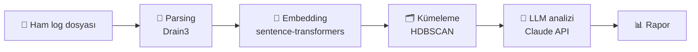

<div align="center">

# 🔍 Log Analiz ve Kök Neden Asistanı

**Binlerce log satırını elle okuma. Hata gruplarını gör, kök nedeni öğren.**

Uygulama loglarını kümeleyip her küme için LLM ile olası kök neden ve çözüm önerisi üreten analiz aracı.


[Problem](#-problem) •
[Nasıl çalışır](#️-nasıl-çalışır) •
[Örnek çıktı](#-örnek-çıktı) •
[Yol haritası](#️-yol-haritası) •
[Riskler](#️-bilinen-riskler)

</div>

---

## 🎯 Problem

Bir uygulama arıza verdiğinde geliştirici binlerce log satırını elle okuyor. Aynı hata yüzlerce kez, küçük farklarla (farklı IP, süre, ID) tekrar ediyor ve asıl sorunu bulmak uzun sürüyor.

Bu proje, ham log dosyasını alıp **benzer hataları gruplar** ve her grup için **olası kök nedeni ve çözümü** önerir.

| | |
|---|---|
| 👤 **Kullanıcı** | Arıza sonrası loglara bakan geliştirici veya DevOps mühendisi |
| 📥 **Girdi** | Tek bir ham log dosyası (`.log` / `.txt`), ilk sürümde 10.000-100.000 satır |
| 📤 **Çıktı** | Hata gruplarını, zaman aralıklarını ve LLM analizini içeren rapor |

---

## ⚙️ Nasıl çalışır?



| Adım | Ne yapar? | Örnek |
|---|---|---|
| **1. Parsing** | Değişken kısımları (IP, sayı, ID) maskeleyip log şablonu çıkarır | `Connection timeout after 30s (host=10.0.0.5)` → `Connection timeout after <NUM>s (host=<IP>)` |
| **2. Embedding** | Şablonları anlamsal vektörlere çevirir | Benzer anlamlı mesajlar birbirine yakın vektör olur |
| **3. Kümeleme** | Benzer hataları gruplar, gürültüyü ayırır | 50.000 satır → 5-10 anlamlı küme |
| **4. LLM analizi** | Her küme için kök neden, güven seviyesi ve çözüm üretir | JSON çıktı |
| **5. Rapor** | Kümeleri büyükten küçüğe sıralayıp gösterir | Boyut, zaman aralığı, örnek satırlar, öneri |

---

## 📋 Örnek çıktı

> ### Grup 1: 1.240 satır `ERROR` · 14:00 → 14:10
>
> **Örnek şablon:** `Connection timeout after <NUM>s (host=<IP>)`
>
> | | |
> |---|---|
> | **Olası kök neden** | Veritabanı bağlantı havuzu doluyor |
> | **Güven** | 🟡 Orta |
> | **Öneri** | Havuz boyutunu artır, yavaş sorguları kontrol et |

---

## 🚫 Kapsam dışı (ilk sürüm)

- Gerçek zamanlı log akışı
- Otomatik düzeltme / kod değiştirme
- Kullanıcı girişi, çoklu kullanıcı
- Dashboard ve alarm sistemi

---

## ✅ Başarı kriterleri

- [ ] Kümeler elle bakınca mantıklı görünüyor (benzer hatalar aynı grupta)
- [ ] Bilinen bir arıza senaryosunda (örn. disk dolu) sistem doğru nedeni öneriyor
- [ ] 50.000 satırlık dosya birkaç dakikadan kısa sürede işleniyor

---

## ⚠️ Bilinen riskler

| Risk | Önlem |
|---|---|
| Parsing kalitesi kötü olursa kümeleme de kötü olur | Şablonları elle incele, gerekirse maskeleme kurallarını ayarla |
| LLM kök nedeni uydurabilir | Güven seviyesi iste, "emin değilsen belirt" talimatı ver, çıktıyı elle doğrula |
| Loghub verisinde gerçek "kök neden" etiketi yok | Kümeleme için hazır şablon etiketlerini, LLM için kendi hazırladığım arıza senaryolarını kullan |

---

## 🗺️ Yol haritası

| Aşama | Durum |
|---|---|
| Proje tanımı | ✅ Tamamlandı |
| Veri seti seçimi (Loghub) | ✅ Tamamlandı |
| Log parsing | ✅ Tamamlandı |
| Embedding | ⬜ |
| Kümeleme | ⬜ |
| LLM ile kök neden analizi | ⬜ |
| Arayüz | ⬜ |
| Değerlendirme | ⬜ |
| Dokümantasyon ve yayın | ⬜ |

---

## 📁 Planlanan proje yapısı

```
log-analyzer/
├── parser.py        # Drain3 ile şablon çıkarma
├── embedder.py      # Vektör üretimi
├── clusterer.py     # HDBSCAN kümeleme
├── analyzer.py      # LLM çağrıları
├── api.py           # FastAPI
├── app.py           # Streamlit arayüz
├── tests/
└── README.md
```

---

## 📄 Lisans

[MIT](LICENSE)
